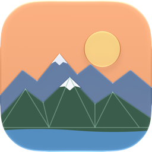
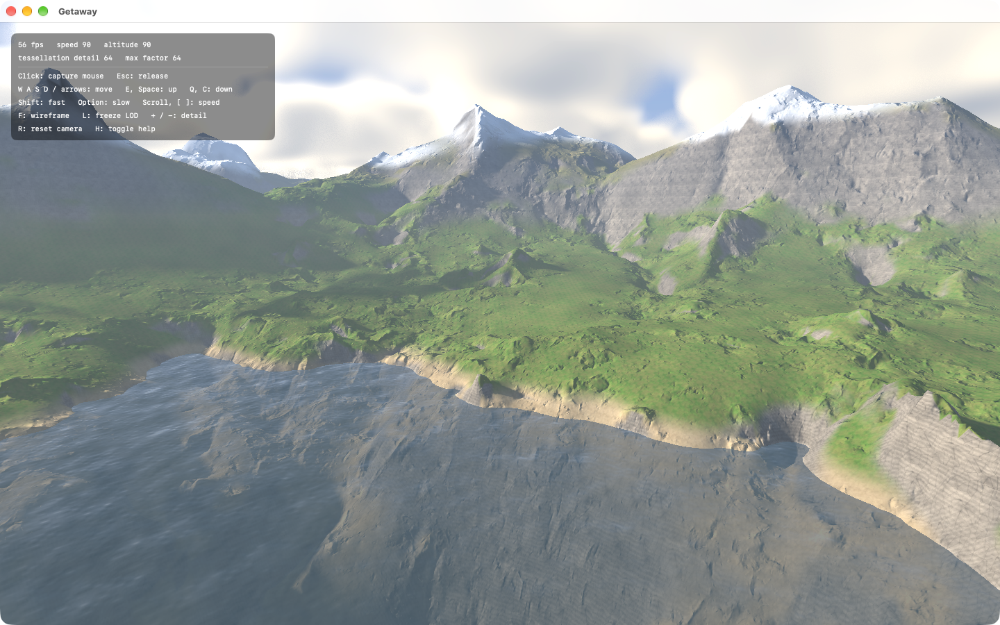
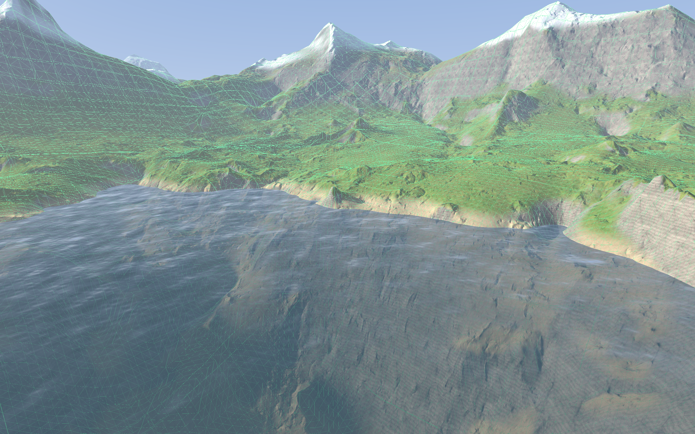

<p align="center"></p>

<h1 align="center">Getaway</h1>

A multiplatform (macOS, iOS/iPadOS, visionOS) Metal app that renders a procedural landscape using GPU hardware tessellation. Terrain gains detail as the camera gets closer, and you explore it with a free-flying camera.



## Features

- **Distance-based tessellation.** The terrain is a 128 × 128 grid of quad patches covering 8,192 units. Every frame, a compute kernel calculates each patch edge's tessellation factor from its distance to the camera. Shared edges get identical factors, so neighbouring patches never crack. Patches outside the view frustum get a factor of 0 and are culled.
- **Procedural heightfield.** A post-tessellation vertex shader displaces each vertex using derivative-damped fBm noise (10 octaves), which gives an eroded look. Per-pixel normals use 11 octaves, with a sampling step that widens with distance.
- **GPU-generated materials.** Seamlessly tiling grass, sand, rock and snow textures (1024², mipmapped texture array) are generated by a compute kernel at launch. No image assets are needed.
- **Material blending.** Sand appears near the waterline, drier ground at mid altitude, rock on steep slopes (triplanar mapped) and snow on high, flatter ground.
- **Lighting and atmosphere.** Sun lighting with ray-marched heightfield soft shadows, sky ambient, an analytic sky with a sun disk, distance fog, and depth-aware volumetric sun shafts.
- **Volumetric clouds.** Animated 3D clouds are ray-marched in a depth-aware compositing pass, so they can surround the camera and correctly pass behind or obscure terrain and water. Cloud coverage also casts moving shadows across the landscape.
- **Water.** An animated, translucent water plane with Fresnel reflection of the sky, cloud-attenuated sun highlights, and volumetric lighting.
- **Wireframe overlay and LOD freeze** for inspecting how the tessellation changes.



## Requirements

- Xcode 27 or later. You also need the Metal Toolchain component; if it's missing, install it with:

  ```sh
  xcodebuild -downloadComponent MetalToolchain
  ```

- A device with a Metal GPU that supports tessellation (any Apple silicon Mac or recent iPhone, iPad or Vision Pro).

## Building

Open `Getaway.xcodeproj`, choose the **Getaway** scheme and a destination (My Mac, an iPhone/iPad, or Apple Vision Pro), then run.

From the command line:

```sh
xcodebuild -project Getaway.xcodeproj -scheme Getaway -destination 'platform=macOS' build
```

## Swift Playgrounds (iOS / iPadOS)

`GetawayPlayground.swiftpm` is an app playground version for Swift Playgrounds 4+ on iPad or iPhone (iOS 17 or later).

1. Copy or AirDrop the `GetawayPlayground.swiftpm` folder to the device (zip it first if your transfer method needs a single file), or drag it into Swift Playgrounds on a Mac.
2. Open it in Swift Playgrounds and tap Run.

The Metal shaders are compiled from source at launch, since Swift Playgrounds can't be relied on to build `.metal` files, so the first start takes a moment. The playground is generated from the files in `Getaway/`; don't edit it by hand. After changing app code or shaders, regenerate and commit it:

```sh
scripts/make-playground.sh
```

## Controls

| Action | macOS | iOS / iPadOS |
| --- | --- | --- |
| Look | Click to capture the mouse (Esc releases), or drag | Drag (works with a trackpad or mouse) |
| Move | W A S D / arrow keys | W A S D with a hardware keyboard, or hold two fingers to fly forward |
| Up / down | E or Space / Q or C | E or Space / Q or C |
| Fast / slow | Shift / Option | Shift / Option |
| Base speed | Scroll wheel, `[` `]` | Trackpad scroll, `[` `]` |
| Wireframe | F | F |
| Freeze LOD | L | L |
| Tessellation detail | `+` / `-` | `+` / `-` |
| Reset camera | R | R |
| Toggle help | H | H |

"Freeze LOD" keeps tessellation calculated from where the camera was when you pressed L. Fly away to see how detail falls off around that point.

## Project layout

| File | Purpose |
| --- | --- |
| `Getaway/ShaderCommon.h` | Uniform layout, noise, terrain height function, sky and fog |
| `Getaway/Terrain.metal` | Tessellation factor kernel plus terrain, wireframe, sky, water, volumetric cloud and sun-shaft shaders |
| `Getaway/MaterialTextures.metal` | Procedural tiling ground textures |
| `Getaway/Renderer.swift` | Metal setup, pipelines, offscreen scene targets and depth-aware cloud compositing (`TerrainConfig` holds tunables) |
| `Getaway/FlyCamera.swift` | Free-fly camera |
| `Getaway/InputState.swift` | Platform-neutral input state |
| `Getaway/TerrainMTKView.swift` | `MTKView` subclasses handling AppKit and UIKit keyboard, mouse and touch input |
| `Getaway/MetalTerrainView.swift` | SwiftUI wrapper |
| `Getaway/ContentView.swift` | Root view and HUD overlay |
| `Getaway/ShaderLibrary.swift` | Loads the compiled shader library (the playground swaps in a runtime-compiling version) |
| `scripts/make-playground.sh` | Generates `GetawayPlayground.swiftpm` from the app sources |
| `GetawayPlayground.swiftpm` | Generated Swift Playgrounds app (do not edit) |
| `Getaway/AppIcon.icon` | Layered Liquid Glass app icon (edit in Icon Composer) |

## Notes

- The maximum tessellation factor is 64 on macOS and 16 on iOS and visionOS (hardware limits). Terrain is therefore densest on the Mac.
- `Uniforms` in `Renderer.swift` must stay layout-compatible with `Uniforms` in `ShaderCommon.h`.
- The scene first renders into shader-readable color and reversed-Z depth textures. A full-screen pass then composites volumetric clouds and light shafts up to the nearest scene depth.
- On visionOS the app runs as a windowed (non-immersive) view.
