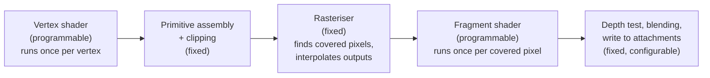
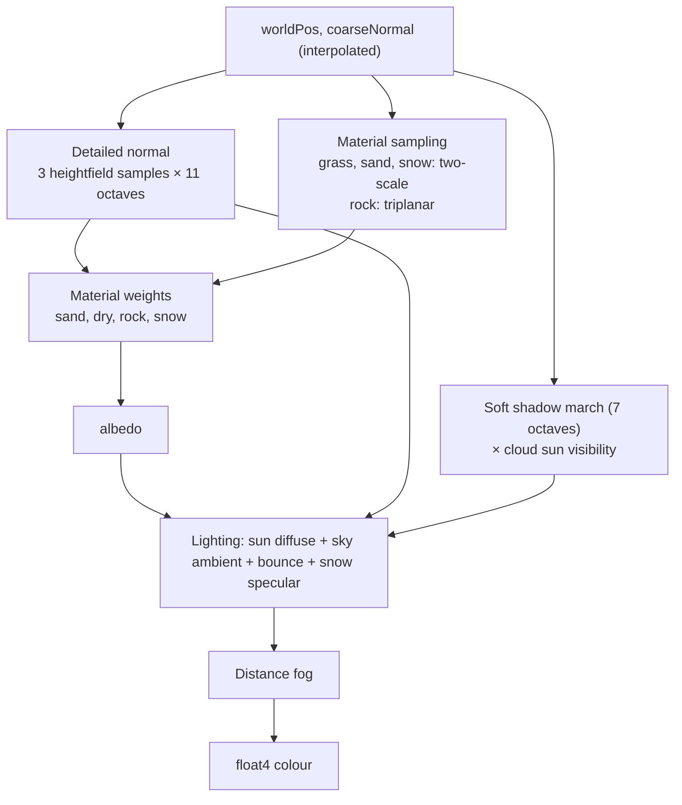

# 1. Vertex and fragment shaders

This page explains the basic graphics pipeline model, then walks through every non-cloud, non-tessellation shader in `Terrain.metal` and `ShaderCommon.h`: the sky, terrain surface, wireframe and water. Tessellation and clouds have their own pages.

- [The pipeline model](#the-pipeline-model)
- [Metal Shading Language essentials](#metal-shading-language-essentials)
- [Shared code: `ShaderCommon.h`](#shared-code-shadercommonh)
- [Sky: a fullscreen triangle](#sky-a-fullscreen-triangle)
- [Terrain surface shading](#terrain-surface-shading)
- [Wireframe overlay](#wireframe-overlay)
- [Water](#water)
- [Cost notes](#cost-notes)

## The pipeline model

A render pipeline turns vertices into coloured pixels in fixed stages. You write two of them (vertex and fragment); the GPU does the rest.



1. **Vertex shader.** Input: one vertex (from a vertex buffer, a generated vertex ID, or, for tessellation, a position inside a patch). Output: a clip-space position `float4` (marked `[[position]]`) plus any extra values the fragment shader will want (world position, normal, …).
2. **Clipping and perspective divide.** Clip-space `(x, y, z, w)` is divided by `w` to give normalised device coordinates (NDC). In Metal, NDC `x, y ∈ [−1, 1]` and `z ∈ [0, 1]`. Triangles outside that volume are clipped.
3. **Rasterisation.** The GPU determines which pixel centres each triangle covers and **interpolates** every vertex output across the triangle. Interpolation is perspective-correct by default, so a texture coordinate or world position varies correctly in 3D, not linearly in screen space.
4. **Fragment shader.** Input: the interpolated values for one pixel. Output: a colour (here `float4`, written to colour attachment 0).
5. **Per-pixel operations.** The depth test compares the fragment's depth against the depth buffer (this project: `.greater`, reversed-Z) and either discards the fragment or writes it. Blending can combine the result with what is already in the target (used for water).

There is also a compute kernel stage (`terrainTessFactors`, `generateMaterials`) which is not part of this pipeline; it is a general-purpose parallel program covered on the tessellation page.

### Where the pipelines are created

`Renderer.init` builds one `MTLRenderPipelineState` per vertex/fragment pairing:

| Pipeline | Vertex | Fragment | Notes |
| --- | --- | --- | --- |
| Terrain | `terrainVertex` | `terrainFragment` | Tessellation settings and a vertex descriptor; depth attachment |
| Terrain Wireframe | `terrainVertex` | `terrainWireFragment` | Same descriptor, different fragment function |
| Sky | `skyVertex` | `skyFragment` | Depth attachment present, but depth compare `.always` with writes off |
| Water | `waterVertex` | `waterFragment` | Alpha blending on; depth attachment |
| Volumetric Clouds | `skyVertex` | `cloudFragment` | No depth attachment (composite pass) |

Each also fixes the colour attachment format (`view.colorPixelFormat` = `bgra8Unorm_srgb`) and depth format (`depth32Float`). A pipeline is only valid with render passes whose attachment formats match.

A separate **depth-stencil state** object holds the depth compare function and write flag. There are four:

| State | Compare | Writes depth | Used by |
| --- | --- | --- | --- |
| `skyDepthState` | `.always` | no | sky (never rejected, never occludes) |
| `terrainDepthState` | `.greater` | yes | terrain |
| `wireDepthState` | `.greaterEqual` | no | wireframe (passes on the already-drawn surface, does not disturb depth) |
| `waterDepthState` | `.greater` | yes | water (hidden behind terrain, hides terrain below it) |

## Metal Shading Language essentials

MSL is C++14-based. The parts used here:

```metal
vertex   Out  name(In in [[stage_in]], uint vid [[vertex_id]], constant Uniforms& u [[buffer(1)]]);
fragment float4 name(Out in [[stage_in]], texture2d<float> t [[texture(0)]], sampler s [[sampler(0)]]);
kernel   void name(uint tid [[thread_position_in_grid]], …);
```

| Concept | Meaning |
| --- | --- |
| `vertex` / `fragment` / `kernel` | Which stage the function is an entry point for |
| `[[stage_in]]` | The struct filled by the previous stage (vertex attributes into the vertex shader, interpolated vertex outputs into the fragment shader) |
| `[[position]]` | Marks the member of the vertex output that is the clip-space position; in a fragment function it instead carries the pixel coordinates (used in `cloudFragment` as `in.position.xy`) |
| `[[buffer(n)]]`, `[[texture(n)]]`, `[[sampler(n)]]` | Argument-table slots, matching `setVertexBuffer`, `setFragmentTexture`, … on the CPU |
| `constant` address space | Read-only, cached, for small uniform data (`Uniforms`) |
| `device` address space | Read/write GPU memory (the control-point and factor buffers) |
| `float4x4`, `float2x2` | Column-major matrices; `M * v` multiplies as in linear algebra |
| `float3(p.xyx)` swizzles | Any component order, e.g. `p.zyx` |
| `mix(a, b, t)` | Linear interpolation `a·(1−t) + b·t` |
| `smoothstep(e0, e1, x)` | 0 below `e0`, 1 above `e1`, smooth cubic ramp between: `t = clamp((x−e0)/(e1−e0), 0, 1); t²(3−2t)` |
| `saturate(x)` | `clamp(x, 0, 1)` |
| `fract`, `floor` | Fractional and integer parts, the basis of the hash and noise functions |
| `inline` helpers | Ordinary functions the compiler inlines; no recursion, no function pointers in this code |

Metal shaders compile in **fast-math** mode by default, which allows reassociation and assumes no NaN/Inf. That matters here wherever a division could hit zero: the code guards these with `max(…, small)` (for instance `max(dist, 1e-4)` in `applyFog`, `max(distance, 1.0)` in the tessellation kernel).

## Shared code: `ShaderCommon.h`

Both `.metal` files include this header. (The Swift Playgrounds variant pastes it into one string, see `scripts/make-playground.sh`.)

### Hash and value noise

```metal
inline float hash12(float2 p) {
    float3 p3 = fract(float3(p.xyx) * 0.1031);
    p3 += dot(p3, p3.yzx + 33.33);
    return fract((p3.x + p3.y) * p3.z);
}
```

A hash maps a 2D lattice coordinate to a pseudo-random number in `[0, 1)` with no memory or random-number state. It is a short sequence of multiplies, `fract`s and dot products that scrambles the bits of the input. Because it is a pure function, every pixel and vertex that asks about lattice point `(3, 7)` gets the same answer, which is what makes noise reproducible across draws and across the shared edges of adjacent terrain patches.

```metal
inline float3 noised(float2 x)   // returns (value, d value/dx, d value/dy)
```

`noised` is **value noise with an analytic derivative**:

1. Split `x` into the lattice cell `i = floor(x)` and the position inside it `f = x − i`.
2. Hash the four cell corners (`a, b, c, d`) into `[−1, 1]`.
3. Blend them bilinearly, but using a *quintic* fade curve `u = 6f⁵ − 15f⁴ + 10f³` instead of `f`. The quintic has zero first and second derivative at 0 and 1, so the noise has continuous curvature across cell boundaries (no visible grid in shading).
4. Return the value and its exact derivative `du = 30f²(f−1)²`‑shaped term combined with the corner differences. Computing the gradient analytically avoids extra noise samples. The terrain uses it for the erosion trick below.

The expression `a + k1·u.x + k2·u.y + k4·u.x·u.y` is the bilinear blend rewritten as a polynomial in `u`, with `k1 = b−a`, `k2 = c−a`, `k4 = a−b−c+d`.

### Terrain height: derivative-damped fBm

```metal
inline float terrainHeight(float2 p, float4 terrainParams, int octaves) {
    float2 x = p * terrainParams.y;     // base frequency 1/900
    float a = 0.0, b = 1.0;  float2 d = float2(0.0);
    for (int i = 0; i < octaves; ++i) {
        float3 n = noised(x);
        d += n.yz;                       // accumulate slope
        a += b * n.x / (1.0 + dot(d, d));// damp by accumulated slope²
        b *= 0.5;                        // amplitude halves
        x = kOctaveRotation * x * 2.0;   // frequency doubles, domain rotated
    }
    return a * terrainParams.x;          // scale by height (300)
}
```

*fBm* (fractal Brownian motion) sums several octaves of noise, each at twice the frequency and half the amplitude of the last. Plain fBm looks like uniformly lumpy clouds. This version adds two ideas:

- **Slope damping.** `d` accumulates the noise gradient from all octaves so far. Each new octave's contribution is divided by `1 + |d|²`. Where earlier octaves already made the surface steep, fine detail is suppressed; flat areas keep their detail. That mimics erosion, in which steep faces are smooth and the detail shows up in valleys and flats.
- **Octave rotation.** `kOctaveRotation` is a 2×2 rotation by about 36.9° (the matrix `(0.8, 0.6; −0.6, 0.8)`, i.e. a 3‑4‑5 triangle). Rotating each octave breaks up the axis-aligned grid pattern of value noise.

Height range: `|a| ≤ Σ 0.5ⁱ < 2` for any octave count, so `|height| < 2 × 300 = 600`. The tessellation culling code relies on this bound (`maxH = 2 * heightScale`).

The `octaves` argument lets each caller pay only for the detail it needs:

| Constant | Octaves | Used for |
| --- | --- | --- |
| `kGeometryOctaves` | 10 | Final vertex displacement |
| `kNormalOctaves` | 11 | Per-pixel normal (one octave finer than the mesh) |
| `kShadowOctaves` | 7 | Shadow ray marching (low detail is enough for soft shadows) |
| 6 | | Per-vertex "coarse normal" |
| 5 | | Tessellation factor edge-midpoint height |

### Sky and fog

```metal
inline float3 skyColor(float3 dir, float3 sun)
```

An analytic gradient, with no textures: `mix(horizon, zenith, pow(saturate(dir.y), 0.45))`; the exponent below 1 keeps the horizon colour low in the sky and pushes the blue up quickly. Below the horizon the colour blends towards a darker horizon tint (`saturate(−dir.y * 3)`). A warm glow around the sun is added: `pow(s, 6) × 0.25` is a wide halo and `pow(s, 64) × 0.5` a tighter one, where `s = saturate(dot(dir, sun))`.

```metal
inline float3 applyFog(float3 color, float3 worldPos, float3 camera, float3 sun)
```

Exponential distance fog: `fog = 1 − exp(−dist × 0.00032)`. At 1,000 units fog is about 27%, at 3,125 units about 63%, at 8,000 about 92%. The fog colour is `skyColor` in the direction of the surface, so distant terrain blends into the sky *including the sun glow* behind it, rather than into a flat grey.

## Sky: a fullscreen triangle

The sky and cloud passes need to run a fragment shader over every pixel of the screen. The simplest geometry for that is **one oversized triangle** generated from the vertex ID, with no vertex buffer at all:

```metal
vertex SkyVertexOut skyVertex(uint vid [[vertex_id]]) {
    float2 p = float2((vid << 1) & 2, vid & 2);
    out.ndc = p * 2.0 - 1.0;
    out.position = float4(out.ndc, 0.0, 1.0);
}
```

| `vid` | `p` | `ndc` |
| --- | --- | --- |
| 0 | (0, 0) | (−1, −1) |
| 1 | (2, 0) | (3, −1) |
| 2 | (0, 2) | (−1, 3) |

```
 y
 3 ┤ 2
   │ │╲
   │ │  ╲
 1 ┤ │ ┌───┐ ╲        ┌───┐ = visible NDC square [-1,1]²
   │ │ │   │   ╲      the triangle covers it completely;
-1 ┤ 0─┴───┴─────1    the rest is clipped away
     -1    1     3  x
```

A triangle is used instead of a two-triangle quad so there is no diagonal seam, and no pixel is shaded twice along it. The draw call is `drawPrimitives(type: .triangle, vertexStart: 0, vertexCount: 3)`.

`z = 0` in reversed-Z means the far plane. Together with `skyDepthState` (`.always`, no write) the sky is drawn behind everything and leaves the depth buffer at its cleared value `0`. That is how the cloud pass later recognises sky pixels.

### `skyFragment`: turning a pixel into a view ray

```metal
float4 world = u.invViewProjection * float4(in.ndc, 0.5, 1.0);
float3 dir = normalize(world.xyz / world.w - u.cameraPosition.xyz);
```

The fragment knows its pixel's NDC `(x, y)`. Pick any depth (0.5 here) to get a point on that pixel's view ray, un-project it with the inverse view-projection matrix, divide by `w` (the perspective divide in reverse), subtract the camera position and normalise. Any depth gives the same *direction*, so the choice is arbitrary. The result is the world-space direction the pixel looks in.

Then `skyColor(dir, sun)` gives the gradient, and a sun disc is added:

```metal
color += smoothstep(0.9992, 0.9997, dot(dir, sun)) * float3(4.0, 3.6, 3.0);
```

`dot(dir, sun)` is the cosine of the angle to the sun. `acos(0.9992) ≈ 2.3°` and `acos(0.9997) ≈ 1.4°`, so the disc fades from full to nothing between 1.4° and 2.3° of the sun's centre. The real sun is about 0.27° in radius, so this one is intentionally much larger. The colour channels exceed 1 (HDR), so the disc clips to white at the output; there is no tone-mapping pass anywhere in these shaders.

## Terrain surface shading

### Vertex stage

The terrain vertex shader is a *post-tessellation* vertex function and is covered on [page 2](02-tessellation.md#the-post-tessellation-vertex-shader). Its outputs are what the fragment shader uses:

```metal
struct TerrainVertexOut {
    float4 position [[position]];
    float3 worldPos;       // interpolated across each triangle
    float3 coarseNormal;   // low-detail normal, interpolated
};
```

### Fragment stage: `terrainFragment`

The function runs for every covered pixel, and it is by far the most expensive shader in the project. The steps, in order:



#### 1. Per-pixel normal

```metal
float eps = max(0.05, dist * 0.0015);
float h0 = terrainHeight(wp.xz,                 …, kNormalOctaves);
float hx = terrainHeight(wp.xz + float2(eps,0), …, kNormalOctaves);
float hz = terrainHeight(wp.xz + float2(0,eps), …, kNormalOctaves);
float3 n = normalize(float3(h0 - hx, eps, h0 - hz));
```

For a heightfield `y = h(x, z)` the surface normal is proportional to `(−∂h/∂x, 1, −∂h/∂z)`. Forward differences give `∂h/∂x ≈ (hx − h0)/eps`; multiplying the whole vector by `eps` yields `(h0 − hx, eps, h0 − hz)`, which is what the code builds. The **step size grows with distance** (`0.15%` of it, minimum 0.05): far away, a tiny step would sample noise at finer than pixel scale, producing sparkling aliasing; a wider step low-passes the normal automatically.

This normal uses one octave more than the mesh (11 vs 10), so even at the highest tessellation the lighting shows detail the geometry does not, which also means normal detail stays smooth as the tessellation level changes.

#### 2. Two normals: why

`n` (fine, per-pixel) is used for *lighting*. `cn` (the interpolated `coarseNormal`, 6 octaves) is used for *material selection* (`slope`) and triplanar weights. High-frequency normals would make the rock/grass boundary jitter pixel to pixel; the smoother normal gives stable material regions.

#### 3. Materials

The texture is a 4-layer `texture2d_array` generated at launch by `generateMaterials` (layers: 0 grass, 1 sand, 2 rock, 3 snow). Sampling:

- **Two-scale sampling** (`sampleTwoScales`): sample the texture at `uv` and again at `uv × 0.137` with an offset, then `mix(near, far, 0.4)`. The second, much lower frequency sample breaks up the visible tiling repetition. The irrational-looking scale and offset keep the two tilings from lining up.
- **Triplanar mapping** (`sampleTriplanar`) for rock: steep faces stretch a top-down projection badly, so rock is projected along all three axes and blended with weights `|n|⁴` normalised to sum to 1. The power sharpens the blend so each face is dominated by the best-aligned projection.

World-space UVs are `wp.xz / 7`, so the base texture repeats every 7 world units.

#### 4. Material weights

```metal
float variation = noised(wp.xz * 0.008).x;   // large-scale noise to break up bands
float slope = 1.0 - cn.y;                    // 0 = flat, 1 = vertical

wSand = 1 - smoothstep(water + 3, water + 12, wp.y + variation * 5);        // near waterline
wDry  = smoothstep(0.35*hs, 0.65*hs, wp.y + variation * 30) * 0.6;          // dry ground, mid altitude
wRock = smoothstep(0.16, 0.32, slope + variation * 0.06);                   // steep slopes
wSnow = smoothstep(0.72*hs, 0.84*hs, wp.y + variation*40 + n.y*20)
        * (1 - smoothstep(0.35, 0.55, slope));                              // high *and* not too steep
```

Each weight is a `smoothstep` band over height or slope, jittered by the low-frequency `variation` noise so boundaries are organic rather than contour lines. They are applied in layers with `mix`: start from grass, blend in dry sand-tinted ground, then sand, then rock, then snow. Later layers override earlier ones; that ordering is why snow wins over rock only where the slope is shallow (`wSnow` is zero on steep faces), and rock wins over grass on slopes.

A final `albedo *= 0.85 + 0.3 × (noised(wp.xz × 0.03).x × 0.5 + 0.5)` adds ±15% broad brightness variation.

#### 5. Lighting

```metal
float shadow        = terrainShadow(wp + float3(0, 2, 0), sun, u.terrainParams);
float sunVisibility = cloudSunVisibility(wp, sun, u.cameraPosition.w);
float directLight   = shadow * sunVisibility;
float diffuse       = saturate(dot(n, sun)) * directLight;
float3 color = albedo * (diffuse * sunColor + skyAmbient + bounce * tint);
```

- **Sun diffuse**: Lambert's cosine law `max(0, n·sun)`, multiplied by two visibility terms:
  - `terrainShadow`: soft shadow from the heightfield. It marches from just above the surface towards the sun, at most 24 steps. At each step it computes `h`, the height of the ray above the terrain (7 octaves). The penumbra estimate is `res = min(res, 12·h/t)`: a ray that passes close to terrain relative to its distance `t` is partially occluded, and the factor 12 sets the softness. The step is `clamp(0.6·h, 3, 120)` so the ray moves fast through open air and slowly near the surface. It stops early if the ray rises above the maximum terrain height (600) or becomes fully occluded (`res < 0`). The maximum reach is 24 × 120 = 2,880 units.
  - `cloudSunVisibility`: how much of the sun is blocked by clouds above this point; see [the cloud page](03-volumetric-clouds.md#cloud-shadows-on-the-ground-and-water).
- **Sky ambient**: a hemisphere term, `mix(dark brownish, sky blue, n.y × 0.5 + 0.5)`, so upward-facing surfaces get blue light and downward ones get dim warm light.
- **Bounce**: a small warm term for surfaces facing *away* from the sun's horizontal direction (`dot(n, −sun.xz)`), a cheap stand-in for light bounced from the ground.
- **Snow specular**: a Blinn-Phong highlight `pow(n·h, 40)` weighted by `wSnow` and `directLight`.

The sun colour `(1.0, 0.9, 0.76) × 2.6` is HDR; most terrain does not clip because albedo is below 1 and the output is a single clamped value, but bright snow in direct sun can.

#### 6. Fog

`applyFog` as described above, then `return float4(color, 1.0)`.

## Wireframe overlay

When wireframe is on (key `F`), the renderer draws the same patches a second time with:

- `terrainWirePipeline` (same vertex function, `terrainWireFragment`),
- `encoder.setTriangleFillMode(.lines)`,
- `wireDepthState` (`.greaterEqual`, depth writes off).

`.greaterEqual` is necessary because the wireframe triangles are at exactly the depth already written by the filled pass; a strict `.greater` would reject them. The fragment shader just colours by distance: `fade = exp(−dist × 0.0004)` blends from pale blue (far) to green (near). Fill mode is restored to `.fill` afterwards.

This is how the tessellation levels become visible; see [page 2](02-tessellation.md#seeing-it-wireframe-and-lod-freeze).

## Water

A single quad, not tessellated, with all the detail in the fragment shader.

### Geometry

`waterVertex` emits four corners from a constant array, indexed by `vertex_id`, drawn as a `.triangleStrip` (4 vertices → 2 triangles). The extent is `terrainSize × 2`, so the plane spans ±16,384 units on x and z at height `waterLevel` = −45. It is bigger than the terrain, so the water reaches past the terrain edge towards the horizon. Water is drawn after terrain with depth testing, so the terrain hides the water wherever it rises above −45.

### Surface normal from three wave layers

```metal
float3 w1 = noised(p * 0.04 + float2(t * 0.25, t * 0.18));
float3 w2 = noised(kOctaveRotation * p * 0.11 - float2(t * 0.4, -t * 0.3));
float3 w3 = noised(p * 0.35 + float2(-t * 0.8, t * 0.6));
float2 grad = w1.yz * 0.04 * 1.2 + w2.yz * 0.11 * 0.5 + w3.yz * 0.35 * 0.12;
```

Three noise layers at different frequencies (0.04, 0.11, 0.35), each scrolling in a different direction at a different speed, and the middle one rotated, so the pattern never visibly repeats or moves as a rigid block. The noise derivative is with respect to its *input*, so by the chain rule the derivative with respect to world position is `noise.yz × frequency`; that is the `× 0.04`, `× 0.11`, `× 0.35`. The last factor (1.2, 0.5, 0.12) is each layer's amplitude: big slow swells matter most, fine ripples least. The sum is the water height gradient, and `n = normalize(−grad.x, 1, −grad.y)` is built like the terrain normal. `grad *= exp(−dist × 0.0006)` flattens the water with distance, which prevents shimmering aliasing on distant waves.

### Shading

```metal
float3 v = normalize(in.worldPos - camera);   // from camera to surface
float3 r = reflect(v, n);
r.y = abs(r.y);                               // never reflect "into" the ground
float fresnel = 0.02 + 0.98 * pow(1.0 - saturate(dot(-v, n)), 5.0);
color = mix(deep, skyColor(r, sun), fresnel);
```

- **Fresnel** (Schlick's approximation): at head-on view angles water reflects about 2% of light (`F₀ = 0.02`) and is mostly see-through, showing its dark `deep` colour; at grazing angles reflectance approaches 100% and the surface becomes a mirror of the sky. `(1 − cosθ)⁵` is the Schlick curve.
- **Reflection** is the analytic sky, not a rendered reflection: there is no planar reflection or screen-space reflection of terrain or clouds. Terrain is therefore not mirrored in the water.
- `r.y = abs(r.y)` is a guard: perturbed normals at grazing angles can reflect downward, which would sample the dark below-horizon sky colour; forcing it upward avoids dark artefacts.
- **Sun glint**: `pow(saturate(dot(r, sun)), 400)` is a very tight highlight, scaled by `6 × cloudSunVisibility`, so cloud shadows dim the glint.
- A small diffuse term `n·sun × (1 − fresnel) × 0.12` is added, also cloud-shadowed.
- Distance fog is applied, then **alpha** `mix(0.72, 1.0, fresnel)`. The pipeline blends with `srcAlpha, oneMinusSrcAlpha` for RGB, so near, head-on water lets 28% of the already-rendered scene (the sea floor) show through, and glancing water is opaque.

What the water does not do: it reads no depth, so there is no depth-based colour (shallow-to-deep gradient), shoreline foam or refraction. Those would need the scene depth texture, which exists only after the scene pass.

## Cost notes

A rough count of noise-octave evaluations (each octave is one `noised` call: 4 hashes and a few multiplies), taken from the loop bounds in the code:

| Where | Per | Octave evaluations |
| --- | --- | --- |
| `terrainVertex` | vertex | 10 (height) + 3 × 6 (coarse normal) = 28 |
| `terrainFragment` normal | pixel | 3 × 11 = 33 |
| `terrainFragment` shadow | pixel | up to 24 × 7 = 168 |
| `edgeTessFactor` | patch edge | 5 |

The soft shadow dominates the terrain pixel cost by a wide margin. These are counts from the source, not profiled timings; actual cost depends on the GPU and on how often the shadow loop exits early.
