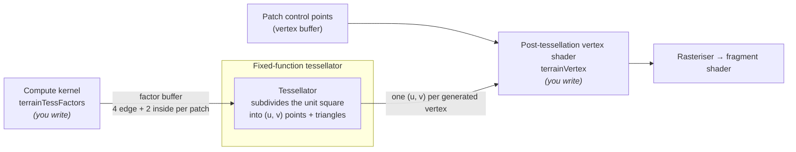
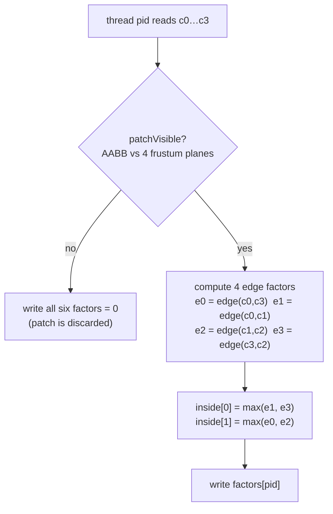

# 2. Tessellation

The terrain is a grid of coarse quad **patches** whose triangle density is decided on the GPU every frame, and then displaced by a procedural height function. Nothing about the terrain mesh exists in memory except 16,384 patches described by four corner points each.

- [Why tessellate](#why-tessellate)
- [Data layout](#data-layout)
- [Metal's tessellation pipeline](#metals-tessellation-pipeline)
- [Step 1: the factor kernel](#step-1-the-factor-kernel)
- [Frustum culling](#frustum-culling)
- [Choosing the factor from distance](#choosing-the-factor-from-distance)
- [Why there are no cracks](#why-there-are-no-cracks)
- [Step 2: draw the patches](#step-2-draw-the-patches)
- [The post-tessellation vertex shader](#the-post-tessellation-vertex-shader)
- [Platform limits](#platform-limits)
- [Seeing it: wireframe and LOD freeze](#seeing-it-wireframe-and-lod-freeze)
- [Tuning and known limitations](#tuning-and-known-limitations)

## Why tessellate

A heightfield that looks detailed up close needs vertices a few units apart. Covering 8,192 × 8,192 units at, say, 2-unit spacing is over 16 million vertices, far too many to draw every frame, and nearly all of them would be sub-pixel in the distance. Hardware tessellation inverts the problem: store a coarse mesh and let the GPU subdivide each piece by an amount chosen *per frame* from the camera distance. Near patches get many triangles, far patches get few.

The alternative of a CPU-built level-of-detail quadtree needs careful stitching logic and per-frame mesh uploads. Here the "mesh" never changes, and the only per-frame work is a compute kernel.

## Data layout

| Item | Value | Source |
| --- | --- | --- |
| Patches per side | 128 | `TerrainConfig.patchesPerSide` |
| Patch size | 64 world units | `TerrainConfig.patchSize` |
| Terrain size | 128 × 64 = 8,192 units | `TerrainConfig.terrainSize` |
| Terrain origin | `−terrainSize/2` = −4,096 on x and z | `Renderer.init` |
| Patch count | 16,384 | `n × n` |
| Control points | 4 per patch, `float2` (x, z) | `controlPointBuffer`, 16,384 × 4 × 8 B = 512 KiB |
| Factors | `MTLQuadTessellationFactorsHalf`, 12 B per patch | `tessFactorBuffer`, 192 KiB, GPU-private |

Control points are stored per patch, winding like this (x to the right, z down the page):

```
 c0 = (x0, z0) ──── c1 = (x1, z0)         u: 0 → 1 along x  (c0 → c1)
      │                    │              v: 0 → 1 along z  (c0 → c3)
 c3 = (x0, z1) ──── c2 = (x1, z1)
```

The control points carry only x and z. Height does not exist until the vertex shader computes it, so the CPU never needs the terrain.

The control-point buffer is created once, `.storageModeShared`, and never touched again. The factor buffer is `.storageModePrivate`: only the GPU writes and reads it, so no CPU access cost.

## Metal's tessellation pipeline

Metal's tessellator is a fixed-function unit between two programmable steps. Unlike older APIs (hull/domain shaders in D3D11, tessellation control/evaluation in GL), Metal's *control* stage is not a shader stage: you compute the tessellation factors yourself, usually in a compute kernel, and put them in a buffer. The *evaluation* stage is an ordinary vertex function, called a **post-tessellation vertex function**.



For a **quad** patch, the tessellator works in the unit square `(u, v) ∈ [0,1]²`. It is told:

- four **edge factors**, how many segments each of the four edges is cut into,
- two **inside factors**, how many segments the interior is cut into along u and along v.

It then emits a grid of vertices and triangles in that unit square. For each generated vertex, Metal calls the vertex function with `[[position_in_patch]]` = that `(u, v)`, plus the patch's original control points via `[[stage_in]]`. The shader's job is to map `(u, v)` and the control points to a real position.

Because the edge factors are independent of the inside factors, patches that share an edge can always agree on that edge's subdivision, regardless of what is happening in their interiors.

### Pipeline state

Set in `Renderer.init` (all on the terrain `MTLRenderPipelineDescriptor`):

| Setting | Value | Meaning |
| --- | --- | --- |
| `tessellationFactorStepFunction` | `.perPatch` | One set of factors per patch (not per instance or per point) |
| `tessellationFactorFormat` | `.half` | Matches `MTLQuadTessellationFactorsHalf` |
| `tessellationPartitionMode` | `.fractionalEven` | See below |
| `tessellationOutputWindingOrder` | `.counterClockwise` | Winding of generated triangles |
| `tessellationControlPointIndexType` | `.none` | Control points are read sequentially, no index buffer |
| `maxTessellationFactor` | 64 (macOS) / 16 (others) | Hardware limit |
| `isTessellationFactorScaleEnabled` | `false` | No extra global factor scale |
| vertex descriptor | attribute 0 = `float2`, `stepFunction = .perPatchControlPoint` | Each patch reads 4 consecutive `float2`s |

`culling` is disabled in the encoder (`setCullMode(.none)`).

**Partition mode `fractionalEven`.** The partition mode defines which factor values map to which subdivisions:

- `integer`, `pow2`: the factor is rounded, and the mesh changes in visible steps ("popping") when the factor crosses a threshold.
- `fractionalEven` / `fractionalOdd`: the tessellator subdivides into an even (or odd) number of segments but places the *extra* vertices so they grow in from existing vertices as the factor increases continuously. As a result a smoothly changing factor produces a smoothly morphing mesh, with no popping. The code uses a continuous distance-based factor, so fractional partitioning is what makes camera movement look smooth.

For even partitioning, Metal limits the factor to a minimum of 2, so a requested factor of 1 behaves like 2 (this is based on Metal's documented factor ranges; it has not been verified on hardware here). The factor kernel clamps to `[1, max]`, which is therefore effectively `[2, max]`.

## Step 1: the factor kernel

`terrainTessFactors` runs once per frame, one thread per patch.

```metal
kernel void terrainTessFactors(constant Uniforms& u [[buffer(0)]],
                               device const float2* controlPoints [[buffer(1)]],
                               device MTLQuadTessellationFactorsHalf* factors [[buffer(2)]],
                               constant uint& patchCount [[buffer(3)]],
                               uint pid [[thread_position_in_grid]])
```

Dispatch (`Renderer.draw`):

```swift
let width = tessFactorPipeline.threadExecutionWidth
compute.dispatchThreadgroups(
    MTLSize(width: (patchCount + width - 1) / width, height: 1, depth: 1),
    threadsPerThreadgroup: MTLSize(width: width, height: 1, depth: 1))
```

`threadExecutionWidth` is the SIMD width (typically 32 on Apple GPUs); the group count rounds up, so the last group may have threads past the end of the array. That is why the kernel begins with `if (pid >= patchCount) { return; }`.



### Edge and inside factor order

Metal defines the order for a quad patch:

| Index | `edgeTessellationFactor[i]` is the edge where | In this code |
| --- | --- | --- |
| 0 | `u == 0` | c0 → c3 (left) |
| 1 | `v == 0` | c0 → c1 (top) |
| 2 | `u == 1` | c1 → c2 (right) |
| 3 | `v == 1` | c3 → c2 (bottom) |

`insideTessellationFactor[0]` controls subdivision in the **u** direction, `[1]` in the **v** direction. The edges that run *along* u are `v == 0` and `v == 1` (indices 1 and 3), so `inside[0] = max(e1, e3)`; likewise `inside[1] = max(e0, e2)`. Taking the max means the interior is at least as fine as its finest bounding edge, so it never looks coarser than its border. Interior triangles do not have to match any neighbour, only the edges do.

A factor of **0 (or negative)** on any edge tells the tessellator to discard the patch entirely: no vertices, no triangles, no vertex shader invocations. The kernel uses this to cull.

## Frustum culling

```metal
inline bool patchVisible(float2 minXZ, float2 maxXZ, constant Uniforms& u) {
    float maxH = 2.0 * u.terrainParams.x;
    float3 bmin = float3(minXZ.x, -maxH, minXZ.y);
    float3 bmax = float3(maxXZ.x,  maxH, maxXZ.y);
    for (int i = 0; i < 4; ++i) {
        float4 plane = u.frustumPlanes[i];
        float3 positive = select(bmin, bmax, plane.xyz >= 0.0);
        if (dot(plane.xyz, positive) + plane.w < 0.0) { return false; }
    }
    return true;
}
```

**The bounding volume.** The patch is turned into an axis-aligned box spanning the patch's x/z extent and the *full possible height range* ±600. This is a conservative box, because the kernel does not know the height of any particular point (it would have to evaluate the noise) and `terrainHeight` is bounded by ±2 × heightScale. The cost is that the box is taller than the real terrain, so a few patches just outside the screen edge are kept.

**The planes.** `Uniforms.frustumPlanes` are the left, right, bottom, top planes, extracted on the CPU in `simd_float4x4.frustumSidePlanes` using the Gribb–Hartmann method. In clip space a point is inside the left plane when `w + x ≥ 0`; since `clip = VP × world`, that reads as `(row3 + row0) · world ≥ 0`, so the plane coefficients are just a sum of two matrix rows:

| Plane | Coefficients |
| --- | --- |
| left | `row3 + row0` |
| right | `row3 − row0` |
| bottom | `row3 + row1` |
| top | `row3 − row1` |

Each is divided by the length of its normal so `dot(n, p) + w` is a true signed distance (positive inside).

**The box-plane test** uses the *positive vertex*: for each plane, the box corner furthest in the direction of the plane normal (`select` picks `bmax` on axes where the normal component is non-negative, else `bmin`). If even that most-inside corner is behind the plane, the entire box is outside, so the patch is culled. If it is in front, the box might intersect the frustum and the patch is kept. The test can have false positives near frustum corners (the box overlaps the plane volume but not the frustum), never false negatives.

**Near and far planes are not tested.** Only four side planes are used. The intersection of the four half-spaces is a pyramid that opens forward from the camera, so patches behind the camera are still rejected by the side planes. The 30,000-unit far plane is larger than the 8,192-unit terrain, so no far test is needed for most positions.

**Frozen LOD does not freeze culling.** Frustum planes always come from the current camera. Only the distance origin (`lodOrigin`) is frozen. This is deliberate: when you freeze LOD and fly away, patches leave and enter view normally while keeping their frozen tessellation.

## Choosing the factor from distance

```metal
inline float edgeTessFactor(float2 a, float2 b, constant Uniforms& u) {
    float2 mid = 0.5 * (a + b);
    float3 m = float3(mid.x, terrainHeight(mid, u.terrainParams, 5), mid.y);
    float dist = max(distance(m, u.lodOrigin.xyz), 1.0);
    float f = u.tessParams.y * distance(a, b) / dist;
    return clamp(f, 1.0, u.tessParams.x);
}
```

1. Take the edge's midpoint in x/z.
2. Look up the terrain height there (5 octaves, a cheap approximation) to get a 3D point `m`. Using the real height matters for mountains: a peak 300 units above the camera's ground-level distance is much closer in 3D than its flat footprint suggests.
3. `dist` = 3D distance from the LOD origin to `m`, at least 1.
4. `f = lodScale × edgeLength / dist`, clamped to `[1, maxFactor]`.

### What the formula means

An edge of length `L` cut into `f` segments has segments of length `L/f = dist / lodScale`. So **segment length is proportional to distance**: each tessellated segment spans about `1/lodScale` of the distance to it. Since apparent size shrinks as `1/distance`, the projected size of a segment on screen is roughly constant, independent of distance, a standard "constant screen-space triangle size" criterion.

With the default `lodScale = 64` and a 60° vertical field of view, a segment at 90° to the view direction covers roughly `(1/64) ÷ (2·tan 30°) ≈ 1.35%` of the screen height. At 1,000 pixels tall that is about 13 pixels per segment edge. (An analytic estimate: it ignores viewing angle and the clamp, and was not measured.)

With `edgeLength = 64`, the unclamped factor is `4096 / dist`:

| Distance | Factor | Segment length |
| --- | --- | --- |
| 64 | 64 | 1 unit |
| 256 | 16 | 4 units |
| 1,024 | 4 | 16 units |
| ≥ 4,096 | ≤ 1 | whole patch (clamped to the minimum) |

The upper clamp is the platform maximum, 64 on macOS and 16 on iOS/visionOS (where the cap is reached at 256 units). Raising detail with `+` multiplies `lodScale` by 1.25 per press (range 4–512); `-` divides by 1.25. On iOS, raising detail past the cap pushes the cap's distance outward but cannot create more triangles near the camera.

### Triangle count

For a patch with edge factors of `f` on all sides the generated mesh is on the order of `2 f²` triangles (about 512 for `f = 16`, about 8,192 for `f = 64`). This is an approximation: the exact count depends on the partition mode and the inside factors.

## Why there are no cracks

A **crack** is a gap between two patches that subdivide their shared edge differently: one has a vertex where the other has none, and after displacement the two surfaces disagree and show the background through the gap.

The renderer avoids cracks by making sure both patches compute **bit-identical** results for the shared edge:

1. **The factor is a function of the edge only.** `edgeTessFactor(a, b)` uses only the edge's two endpoints, nothing about the patch's interior or the other two corners. The adjacent patch calls it with the same two points (possibly in the opposite order) and so produces the same value.
2. **The function is symmetric.** `0.5 * (a + b)` and `distance(a, b)` give the same result for `(b, a)`: float addition is commutative and the distance squares each component difference.
3. **Inside factors do not influence edges.** In Metal's model the edge factors fully determine the subdivision along an edge.
4. **Vertex positions along the edge are computed identically.** For a given `(u, v)`, `p = mix(mix(c0, c1, u), mix(c3, c2, u), v)`. On a shared edge both patches reduce to `mix(shared₁, shared₂, t)` with the same endpoints. This works out exactly because the grid is axis-aligned (the two interpolated points share their x on vertical edges and their z on horizontal ones), every corner coordinate is an integer multiple of 64 (exactly representable in `float`), and parameter `t` runs the same direction in every patch. The same `p` then goes through the same `terrainHeight(p, …, 10)`; noise is a pure hash of position, so equal inputs give equal heights. (This is reasoning from the source; the compiled instruction sequence for `mix` was not inspected.)
5. **Culling does not create holes.** A culled patch has factor 0 and draws nothing, but it is culled only when it lies outside the view frustum, so a visible patch bordering it has its shared edge at the screen boundary.

AGENTS.md records this as an invariant: *terrain patch edges must derive tessellation factors identically on both adjacent patches.* If `edgeTessFactor` were changed to depend on anything else (for instance the patch centre, or per-patch curvature), cracks would appear.

```
   patch A                 patch B
  ┌────────┐             ┌────────┐
  │        │ f = 8       │        │
  │        ├─┬─┬─┬─┬─┬─┬─┤        │   Both sides use f = edge(a, b):
  │        │   ← same    │        │   same endpoints → same factor →
  │        ├─┴─┴─┴─┴─┴─┴─┤        │   same vertices → no gap
  └────────┘             └────────┘
```

(A can have inside factor 12 while B has inside factor 4. The interior grids differ and that is fine.)

## Step 2: draw the patches

```swift
encoder.setTessellationFactorBuffer(tessFactorBuffer, offset: 0, instanceStride: 0)
encoder.setVertexBuffer(controlPointBuffer, offset: 0, index: 0)
encoder.drawPatches(numberOfPatchControlPoints: 4, patchStart: 0, patchCount: patchCount,
                    patchIndexBuffer: nil, patchIndexBufferOffset: 0,
                    instanceCount: 1, baseInstance: 0)
```

One `drawPatches` call submits all 16,384 patches. The tessellator reads each patch's six factors, discards the zero-factor ones, generates the grids for the rest, and invokes the vertex function per generated vertex. The compute pass and the render pass are in the same command buffer, and Metal's default resource hazard tracking orders the factor writes before the tessellator reads them.

The wireframe overlay calls the same `drawPatches` again with a different pipeline and fill mode (see below).

## The post-tessellation vertex shader

```metal
[[patch(quad, 4)]]
vertex TerrainVertexOut terrainVertex(PatchIn patch [[stage_in]],
                                      float2 uv [[position_in_patch]],
                                      constant Uniforms& u [[buffer(1)]])
```

- `[[patch(quad, 4)]]` declares this as a post-tessellation function for quad patches with 4 control points.
- `PatchIn` wraps `patch_control_point<ControlPoint>`, which Metal fills from the vertex descriptor with the patch's four `float2` corners.
- `uv` is the tessellator-generated point in the unit square.

The body:

1. **Position.** `p = mix(mix(c0, c1, uv.x), mix(c3, c2, uv.x), uv.y)`, a bilinear interpolation of the four corners. This gives the x/z location.
2. **Height.** `h = terrainHeight(p, …, 10)`. World position = `(p.x, h, p.y)`.
3. **Clip position.** `u.viewProjection × worldPos`.
4. **Coarse normal.** Three 6-octave height samples at `p`, `p + (4, 0)` and `p + (0, 4)` give a forward-difference normal, which is interpolated and used by the fragment shader for material choice. The 4-unit step is a fixed world-space distance (unlike the per-pixel normal, whose step scales with distance).

The vertex shader is where "tessellation" becomes "terrain": the subdivided flat grid is pushed up into mountains. Because the displacement is computed from a function of world position, not stored data, detail can be added at any resolution. More tessellation reveals more octaves of that function, which up to the 10th octave are all in the formula already. Beyond the 10th, the per-pixel normal adds one more octave of shading detail without geometry.

## Platform limits

`TerrainConfig.maxTessellationFactor` is 64 on macOS and 16 on every other platform (hardware maximums for this API as stated in `AGENTS.md`). It appears in three places that must agree: the pipeline's `maxTessellationFactor`, `Uniforms.tessParams.x` (the kernel's clamp), and the HUD readout. The practical effect: on iOS, patches closer than 256 units all get the same maximum density (about 16 × 16 cells of 4 units each per patch), so the terrain is visibly coarser there than on the Mac.

## Seeing it: wireframe and LOD freeze

| Key | Effect | How |
| --- | --- | --- |
| `F` | Wireframe | Second `drawPatches` with `terrainWirePipeline`, `setTriangleFillMode(.lines)`, `greaterEqual` depth, no depth write |
| `L` | Freeze LOD | `frozenLODOrigin = camera.position`; `makeUniforms` then uses it as `lodOrigin`, so factors are measured from the frozen point while the camera moves |
| `+` / `−` | Detail | `lodScale × 1.25` / `÷ 1.25` |

A good experiment: turn on wireframe, press `L`, and fly away. Detail stays concentrated around the frozen point, and rings of coarser patches radiate outward, one set of factors per edge. Fly up to see the factor falling off by distance. Patches leaving the screen vanish (culling still uses your live camera).

## Tuning and known limitations

These are properties of the current implementation, listed so they are not mistaken for bugs in a future change.

- **Distance only.** The factor ignores view angle and silhouette. A patch seen edge-on at a ridge gets the same density as one viewed from above, which wastes triangles on faces that are tiny on screen and can under-sample ridges.
- **Midpoint height is a 5-octave approximation.** The distance is to a point on a smoother surface than the final 10-octave mesh.
- **Per-vertex cost is high** (28 noise octave evaluations per vertex), so doubling `lodScale` roughly quadruples vertex work near the camera on macOS.
- **Density steps between neighbours.** Fractional partitioning smooths factor changes over *time* for a given edge, but not across *space*: neighbouring patches can have very different interior densities. Edges always match (no cracks), but the surface shape can change visibly from one patch to the next where the factors differ a lot.
- **The AABB uses a fixed ±600 height.** A flat region still tests as if it could reach 600 units; it only costs extra tessellation work on patches just outside the screen.
- **Only side planes are tested.** For this terrain size and far plane that is sufficient; a larger world would need a far-plane test.
- **Even partitioning minimum.** A requested factor of 1 acts as 2, so far patches always have at least 2 × 2 cells (unverified on hardware, see above).
