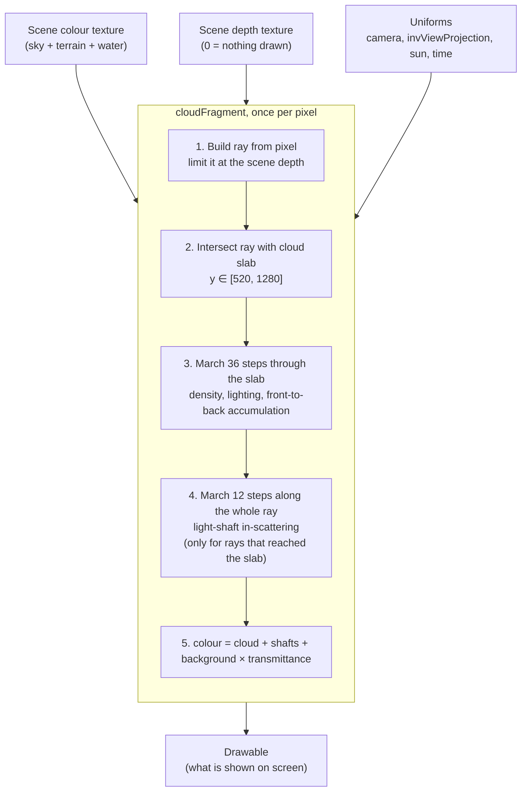

# 3. Volumetric clouds

The clouds are not geometry and not textures. They are a **density function** in 3D space that a fragment shader samples by ray marching, in a fullscreen pass after the terrain has been drawn. Because the pass reads the scene depth, clouds can surround the camera and correctly appear in front of or behind terrain and water. The same pass adds sun light shafts, and a cheaper version of the cloud function darkens the ground where clouds block the sun.

- [Overview](#overview)
- [Ray marching in one page](#ray-marching-in-one-page)
- [The cloud density field](#the-cloud-density-field)
- [Building the ray](#building-the-ray)
- [The march](#the-march)
- [Lighting a sample](#lighting-a-sample)
- [Light shafts](#light-shafts)
- [Final composite](#final-composite)
- [Cloud shadows on the ground and water](#cloud-shadows-on-the-ground-and-water)
- [Cost](#cost)
- [Tunable constants](#tunable-constants)
- [Known limitations](#known-limitations)

## Overview



The pass is drawn with `skyVertex` (the fullscreen triangle from [page 1](01-vertex-and-fragment-shaders.md#sky-a-fullscreen-triangle)) and `cloudFragment`. It has no depth attachment and `loadAction = .dontCare` because every pixel is overwritten.

## Ray marching in one page

A volume has no surface to hit. Instead, for every pixel the shader walks along the view ray in small steps. At each step it asks "how much cloud is here?" (the **density** ρ) and "how much light arrives here?" Contributions are accumulated.

Two physical ideas are used, in simplified form:

**Transmittance (Beer–Lambert law).** Light passing through a medium of density ρ over a distance `d` is attenuated by `exp(−σ·ρ·d)`, where σ is a constant. `T = exp(−τ)`, where `τ = ∫ σρ ds` is the *optical depth*. Doubling the thickness squares the transmittance; this is why thin cloud edges are wispy and thick cores are opaque.

**In-scattering.** Cloud droplets scatter sunlight toward the eye. At each step the amount scattered towards the camera is proportional to the local density, to how much sunlight reaches that point, and to a phase function that says how strongly droplets scatter in the view direction relative to the sun.

Accumulating front to back over steps `i = 0…N−1`:

```
colour        = 0
transmittance = 1
for each step:
    α             = 1 − exp(−σ · ρᵢ · Δs)      // fraction of remaining light absorbed in this step
    colour       += transmittance · α · litColourᵢ
    transmittance *= (1 − α)
result = colour + background · transmittance
```

`α` uses the exact exponential for a step of length `Δs` instead of `ρ·Δs`; that keeps the result stable when `Δs` is large (no overshoot past 1) and makes the final image nearly independent of the step count for a given cloud. The `colour += transmittance · α · lit` line weights each sample's light by how much of it survives the clouds *in front* of it. Samples behind thick cloud contribute almost nothing, which gives correct occlusion without sorting.

## The cloud density field

```metal
inline float cloudDensity(float3 p, float time) {
    constexpr float cloudBottom = 520.0;
    constexpr float cloudTop = 1280.0;
    float height = saturate((p.y - cloudBottom) / (cloudTop - cloudBottom));
    float heightShape = smoothstep(0.0, 0.18, height) * (1.0 - smoothstep(0.62, 1.0, height));

    float3 q = p * 0.00115;
    q.xz += float2(time * 0.012, time * 0.004);
    float base = cloudFBM(q);
    float coverage = noise3D(q * 0.24 + float3(12.0, 0.0, -8.0));
    return saturate((base + coverage * 0.38 - 0.66) * 3.2) * heightShape;
}
```

### The slab and its vertical profile

The clouds live in a horizontal slab from `y = 520` to `y = 1280` (760 units thick). The camera starts at `y = 90`, well below it, but can fly up into and above the layer.

`height` is the normalised position in the slab, 0 at the bottom and 1 at the top. `heightShape` multiplies the density by a vertical envelope:

```
 density multiplier
 1 ┤        ┌──────────────┐
   │       ╱                ╲
   │      ╱                  ╲
 0 ┼─────┴────────────────────┴──→ height in slab
   0    0.18               0.62  1
        ramp up (fast)    flat   fade out (slow)
```

- 0 → 0.18: `smoothstep` ramp up, giving a fairly flat, defined cloud base.
- 0.18 → 0.62: full density.
- 0.62 → 1.0: `1 − smoothstep` fade, giving a soft, billowy top.

The envelope is also what makes the density **exactly zero outside the slab**. Below the bottom, `height` saturates to 0 so `smoothstep(0, 0.18, 0) = 0`. Above the top, `height = 1` and the second factor is 0. Nothing else needs to clip.

### Noise

The shape comes from **3D value noise** (`noise3D`): hash the 8 corners of the lattice cell around the point (`hash13`), smooth the fraction with the cubic `f²(3−2f)`, and trilinearly interpolate. `hash13` is the same style of arithmetic hash used in `ShaderCommon.h` for terrain, extended to 3 inputs. Result in `[0, 1]`.

`cloudFBM` sums three octaves:

```metal
for (int i = 0; i < 3; ++i) {
    value += noise3D(p) * amplitude;           // amplitudes 0.55, 0.275, 0.1375
    p = p * 2.03 + float3(7.1, 3.4, 5.8);      // lacunarity ≈ 2, plus an offset
    amplitude *= 0.5;
}
```

The `2.03` (not exactly 2) and the constant offset stop the octaves' lattices from lining up, which avoids visible repeating structure. The three amplitudes sum to 0.9625.

### From noise to cloud

```
q        = p × 0.00115 + wind
base     = fBm(q)                             // clump-scale shapes, 3 octaves
coverage = noise(q × 0.24 + offset)           // very large-scale "weather" map
ρ        = saturate((base + 0.38·coverage − 0.66) × 3.2) × heightShape
```

1. **Scale.** `p × 0.00115` means one noise lattice cell is about 870 world units across. The three octaves then have features of roughly 870, 430 and 215 units.
2. **Wind.** `q.xz += (0.012·t, 0.004·t)` shifts the noise coordinates over time. Dividing by the scale gives world speed: about 10.4 units/s in x and 3.5 units/s in z. Because the offset is *added* to the sampling coordinates, the pattern appears to move toward −x and −z.
3. **Coverage.** A second, very low-frequency noise (`q × 0.24`, so cells about 3,600 units wide) is added at weight 0.38. Where it is high, more of the base noise clears the threshold: large regions of sky with more cloud and clear gaps between.
4. **Threshold and contrast.** Subtracting 0.66 means only the high part of the noise becomes cloud; the rest is clear sky. Multiplying by 3.2 and saturating makes the transition from empty (0) to full (1) happen over an input range of about 0.31, a fairly crisp but not hard edge. Raising `0.66` gives less cloud, lowering it gives more; raising `3.2` makes edges harder.

   Reading the numbers: the maximum possible `base + 0.38·coverage` is 0.9625 + 0.38 = 1.34, and the mean of `base` is about 0.48 (value noise averages 0.5, times 0.9625), so typical places sit well below the 0.66 threshold. Cloud forms where noise is above average and coverage is high.
5. **Height envelope.** Multiplied last.

The function returns a dimensionless **density in [0, 1]**. The physical scale is set later by the extinction constant `0.012` in the march.

## Building the ray

```metal
uint2 pixel = uint2(in.position.xy);
float3 background = sceneColor.read(pixel).rgb;
```

`in.position` in a fragment function is the pixel coordinate (centre at `.5`, truncated here). Reading with integer coordinates via `read` bypasses sampling and filtering, which is what is wanted for a 1:1 fullscreen pass. Both the scene colour texture and the drawable use `bgra8Unorm_srgb`, so on read the hardware converts sRGB-encoded values to linear, and on write converts back; the maths in the shader is in linear space (this is how sRGB formats behave in Metal in general; it was not checked on a device here).

```metal
float4 farWorld = u.invViewProjection * float4(in.ndc, 0.0001, 1.0);
float3 rayDirection = normalize(farWorld.xyz / farWorld.w - camera);
```

The ray direction is found as in the sky shader: un-project a point on the pixel's ray and normalise. The depth used, 0.0001, is a point very close to the far plane in reversed-Z; any depth would give the same direction.

### Limiting the ray with scene depth

```metal
float rayLimit = 30000.0;
float depth = sceneDepth.read(pixel);
if (depth > 0.000001) {
    float4 hit = u.invViewProjection * float4(in.ndc, depth, 1.0);
    rayLimit = distance(hit.xyz / hit.w, u.cameraPosition.xyz);
}
```

This is the "depth-aware" part. The depth texture holds `0` wherever nothing was drawn (cleared depth; the sky does not write it). A pixel with `depth > 0` is covered by terrain or water. Un-projecting the stored depth with the same `invViewProjection` gives the world position of that surface, and its distance from the camera is how far the ray can travel before hitting something opaque. The march stops there, so clouds are never drawn behind terrain; clouds between the camera and the surface still appear in front of it. Mountains that poke up into the cloud layer are correctly cut off by it.

The threshold `0.000001` avoids treating cleared (or near-far-plane) depth as geometry.

### Intersecting the ray with the slab

```
              cloudTop    ─────────────────────────────  y = 1280
 ray →  ╱                    ↗ exits slab at tTop
      ╱    cloud slab        ╱
    ╱                      ╱
  ╱       cloudBottom ───────────────────────────────  y = 520
 ╱ ← enters slab at tBottom
 camera (y = 90)
```

```metal
float tBottom = (cloudBottom - cam.y) / dir.y;
float tTop    = (cloudTop    - cam.y) / dir.y;
float rayStart = max(min(tBottom, tTop), 0.0);
float rayEnd   = min(max(tBottom, tTop), rayLimit);
if (rayEnd <= rayStart) return background;
```

Each is the ray parameter `t` at which the ray crosses a horizontal plane (`y = cam.y + t·dir.y`). The ray is inside the slab between the two crossings, so start = the nearer crossing, end = the farther. Cases this handles:

| Situation | Result |
| --- | --- |
| Camera below slab, looking up | `tBottom` small positive, `tTop` larger: march from bottom to top |
| Camera inside slab | one of the two is negative, so the start clamps to 0: march from camera |
| Camera above slab, looking down | the top is crossed first: march from top to bottom |
| Looking away from the slab | both `t` negative, so `rayEnd ≤ rayStart` and the pixel passes through unchanged |
| Surface in the way | `rayLimit` clamps `rayEnd`; if the surface is closer than the slab, nothing is marched |

Rays with `|dir.y| < 0.00001` (exactly horizontal) skip the clouds to avoid a divide by zero. If the camera is inside the slab, a perfectly horizontal ray therefore sees no cloud; with floating-point directions the case is rare.

## The march

```metal
constexpr int stepCount = 36;
float stepLength = (rayEnd - rayStart) / float(stepCount);
float jitter = hash13(float3(float2(pixel), floor(u.cameraPosition.w * 24.0)));
float distanceAlongRay = rayStart + jitter * stepLength;
```

**Fixed step count.** Every ray takes 36 steps across its slab segment, however long the segment is. The step length therefore *varies*: a vertical ray through the 760-unit slab steps about 21 units; a shallow ray covers far more. Estimated from the slab geometry (not measured):

| Elevation angle of ray | Segment length (capped at 30,000) | Step length |
| --- | --- | --- |
| 90° (straight up) | 760 | 21 |
| 10° | 4,377 | 122 |
| 5° | 8,720 | 242 |
| 1° | 30,000 (capped) | 833 |

At 833 units per step, the step is as large as the biggest noise feature (870 units), so distant, shallow clouds are heavily undersampled. This is where banding or noise shows first.

**Jitter.** The starting offset inside the first step is random per pixel and changes 24 times a second (`floor(time × 24)`). Without it, every ray would sample at the same depths and produce parallel visible "layers"; with it, the banding turns into fine noise that the eye averages out. There is **no temporal accumulation or denoising** in this renderer, so this noise is visible in the output, especially at grazing angles where steps are large. The same `jitter` value is reused for the light shafts.

### The loop

```metal
for (int i = 0; i < stepCount; ++i) {
    float3 samplePosition = camera + rayDirection * distanceAlongRay;
    float density = cloudDensity(samplePosition, time);
    if (density > 0.002) {
        // … light the sample (below) …
        float sampleAlpha = 1.0 - exp(-density * stepLength * 0.012);
        cloudLight   += transmittance * sampleAlpha * litColor;
        transmittance *= 1.0 - sampleAlpha;
        if (transmittance < 0.015) break;     // early out
    }
    distanceAlongRay += stepLength;
}
```

- **Empty-space skip.** If density is under 0.002 nothing is lit or accumulated, which saves the expensive lighting samples in clear regions.
- **Extinction coefficient.** `σ = 0.012` per world unit at density 1. Optical depth through a full-density column of the slab's thickness is about `0.012 × 760 × 0.72 ≈ 6.6` (0.72 is the average of the height envelope over the slab). `exp(−6.6) ≈ 0.001`, so dense cores are effectively opaque. A full-thickness column at half density has `τ ≈ 3.3` and still blocks about 96% of what is behind it; at density 0.1 it passes about half (`τ ≈ 0.66`). These are estimates from the constants, not measurements, and real columns rarely have uniform density.
- **Early out.** Once 98.5% of the background is occluded, further samples would change the image by less than 1.5% of their strength, so the loop stops.

## Lighting a sample

The colour assigned to each sample, `litColor`, blends a shadowed colour with a sunlit one, depending on how much cloud lies between the sample and the sun.

```metal
float lightDensity = cloudDensity(samplePosition + sun * 130.0, time)
                   + cloudDensity(samplePosition + sun * 300.0, time) * 0.7;
float sunlight = exp(-lightDensity * 1.7);
float3 litColor = mix(float3(0.42, 0.48, 0.58),                    // shadowed: cool ambient
                      float3(1.0, 0.91, 0.76) * (0.75 + phase),    // sunlit: warm, phase-boosted
                      sunlight);
```

### Self-shadowing with two samples

To know whether the sample is shadowed by the cloud around it, the shader would ideally integrate density along the whole path to the sun. Doing that for every step is far too expensive, so it takes **two** extra density samples toward the sun, at 130 and 300 units, with weights 1 and 0.7.

```
              sun
               ↗
              ╱
        300 ●  weight 0.7
           ╱
      130 ●    weight 1.0
         ╱
        ● sample position
  ─────camera ray──────────→
```

`sunlight = exp(−1.7 × lightDensity)` is the Beer–Lambert attenuation applied to that weighted density. The coefficient 1.7 is chosen for appearance, not derived from the extinction in the march: the light samples are 130 and 300 units away, not the whole path to the sun. The maximum `lightDensity` is `1 + 0.7 = 1.7`, so `sunlight` bottoms out at `exp(−2.89) ≈ 0.056`; even deep inside a cloud, 5.6% of the sunlit colour is mixed in. The effect is that clouds are brighter on the sun-facing side and grey-blue where more cloud lies toward the sun.

Because `cloudDensity` is zero outside the slab, samples toward the sun that leave the slab contribute nothing. The sun is about 24° above the horizon, so a 300-unit step toward it climbs about 124 units.

The light samples do not check the terrain, so mountains do not shadow the clouds (the clouds are above them anyway).

### The phase function

Real clouds are much brighter when you look toward the sun, because water droplets scatter forward strongly. The **Henyey–Greenstein** phase function models that with an asymmetry parameter `g` (here 0.62, forward scattering):

```metal
inline float cloudPhase(float cosTheta) {
    constexpr float g = 0.62;
    float denominator = pow(max(1.0 + g*g - 2.0*g*cosTheta, 0.01), 1.5);
    return 0.35 + 0.65 * (1.0 - g*g) / denominator;
}
```

`cosTheta = saturate(dot(rayDirection, sun))` is the cosine of the angle between the view direction and the direction to the sun. The function is the standard HG lobe `(1−g²)/(1+g²−2g·cosθ)^1.5` (without the `1/4π` normalisation) mixed 35/65 with a constant, so even clouds far from the sun are not black.

| Looking | `cosθ` | `phase` | Sunlit colour multiplier `0.75 + phase` |
| --- | --- | --- | --- |
| Away from / perpendicular to the sun | ≤ 0 | 0.60 | 1.35 |
| 60° from the sun | 0.5 | 0.95 | 1.70 |
| 26° from the sun | 0.9 | 3.23 | 3.98 |
| Straight at the sun | 1.0 | 7.64 | 8.39 |

So the lit side of clouds near the sun is up to about six times brighter than elsewhere. The multiplier makes the colour HDR, and since the output is a plain 8-bit sRGB target without tone-mapping, bright regions clip to white.

`dot(rayDirection, sun)` is positive when looking toward the sun, so that is where the forward lobe applies. Because of the `saturate`, any view direction with the sun behind the camera (`dot < 0`) is treated as `cosθ = 0` and gets the flat 0.60 value: there is no separate back-scattering lobe.

`phase` is computed **once per pixel**, not per step. The sun is a directional light and the ray direction is constant along the ray, so the angle is the same for every sample.

## Light shafts

After the cloud march, a second, cheaper loop adds light shafts (crepuscular rays): visible beams where clouds periodically block sunlight in the air between you and a distant surface.

**Which pixels get shafts.** The shaft loop sits *after* the early returns for rays that miss the slab (and for rays whose scene surface is closer than the slab). Only rays that actually enter the cloud slab before hitting something run it. In practice shafts appear in the sky and on distant terrain seen *through* the cloud layer, and not on a ray from the camera that heads down to ground below the layer. That is a consequence of the code's structure, and it is one reason shafts can look patchy near the edge of the slab.

```metal
constexpr int shaftStepCount = 12;
float shaftEnd = min(rayLimit, 12000.0);
float shaftStepLength = shaftEnd / float(shaftStepCount);
float shaftDistance = (0.35 + jitter * 0.65) * shaftStepLength;
float shaftScattering = 0.0;
for (int i = 0; i < shaftStepCount; ++i) {
    float3 p = camera + rayDirection * shaftDistance;
    float airDensity = exp(-max(p.y, 0.0) / 8000.0);
    shaftScattering += cloudSunVisibility(p, sun, time) * airDensity * shaftStepLength;
    shaftDistance += shaftStepLength;
}
```

This integrates `visibility × airDensity` along the **whole** view ray (to the scene surface, or 12,000 units, whichever is closer), not just inside the slab:

- `cloudSunVisibility(p, …)` answers "is the sun reaching this point of air, or is it shadowed by clouds above it?" (see next section).
- `airDensity` is an exponential atmosphere with a scale height of 8,000 units (it halves roughly every 5,500 units of altitude), so low air scatters more than high air.
- Multiplying by `shaftStepLength` is the integration.

The sum is then scaled into a colour:

```metal
float shaftPhase = 0.12 + 2.2 * pow(saturate(dot(rayDirection, sun)), 8.0);
float3 shaftLight = float3(1.0, 0.82, 0.58) * shaftScattering * 0.000012 * shaftPhase
                  * sqrt(transmittance);
```

- `shaftPhase` is a cheap forward-scattering lobe: a 0.12 base plus a term that peaks to 2.32 when looking straight at the sun. Shafts are strongest when facing the sun.
- `0.000012` converts the sum (units ≈ world-distance × air density) into a brightness; it is an empirical constant.
- `sqrt(transmittance)` dims shafts behind thick cloud so they do not glow through a cloud core. The square root keeps them from vanishing too aggressively: a ray with `T = 0.25` keeps half its shaft light.

The shaft loop runs 12 steps with a jittered start `(0.35 + 0.65·jitter)·Δ`, so the first sample is never exactly at the camera.

There is no occlusion by terrain in the shaft integral (it checks only cloud visibility), but because the loop stops at `rayLimit`, shafts only accumulate in front of the visible surface.

## Final composite

```metal
return float4(cloudLight + shaftLight + background * transmittance, 1.0);
```

| Term | Meaning |
| --- | --- |
| `cloudLight` | Light scattered towards the camera from cloud samples, already weighted by the transmittance in front of each sample |
| `shaftLight` | Light scattered by the air along the whole ray |
| `background * transmittance` | The scene behind the clouds (sky, terrain, water), attenuated by the total cloud optical depth along the ray |

If the ray entered the slab but met no cloud (`transmittance = 1`, `cloudLight = 0`) the result is the background plus only shaft light. If it never entered the slab, the early return gives the background unchanged. If the ray hit an opaque core (`transmittance ≈ 0`) the result is almost entirely `cloudLight`.

## Cloud shadows on the ground and water

The terrain and water fragment shaders need to know whether the sun is blocked by clouds at their position. They cannot afford a full ray march per pixel, so `cloudSunVisibility` approximates it with **one** evaluation of a simplified density function:

```metal
inline float cloudSunVisibility(float3 p, float3 sun, float time) {
    constexpr float cloudMiddle = 850.0;
    if (p.y >= 1280.0 || sun.y <= 0.001) return 1.0;

    float distanceToCloud = max((cloudMiddle - p.y) / sun.y, 0.0);
    float3 cloudPoint = p + sun * distanceToCloud;     // where the sun ray crosses the mid-slab plane
    float3 q = cloudPoint * 0.00115;
    q.xz += float2(time * 0.012, time * 0.004);

    float shape = volumeNoise3D(q) * 0.68
                + volumeNoise3D(q * 2.03 + float3(7.1, 3.4, 5.8)) * 0.32;
    float coverage = volumeNoise3D(q * 0.24 + float3(12.0, 0.0, -8.0));
    float extinction = saturate((shape + coverage * 0.38 - 0.66) * 3.2);
    return exp(-extinction * 2.8);
}
```

```
        sun ray
          ╲
   slab ──────●─────────  y = 850  (middle of the slab)
            ╲  cloudPoint = p + sun·(850 − p.y)/sun.y
              ╲
   ground ──────● p   ← surface point asking "is my sun blocked?"
```

1. Above the layer, or with the sun below the horizon (`sun.y ≤ 0.001`), return 1 (fully visible).
2. Walk from `p` along the sun direction to the horizontal plane at `y = 850`. `distanceToCloud = (850 − p.y)/sun.y`, clamped at 0 for points already above the middle of the slab.
3. Evaluate the cloud noise there, with the same scale, wind and coverage as `cloudDensity`, so shadows drift with the clouds.
4. Convert density to visibility: `exp(−2.8 × extinction)`. Full cloud (extinction 1) leaves `exp(−2.8) ≈ 6%` of the sun.

It is used in three places:

| Caller | Use |
| --- | --- |
| `terrainFragment` | `directLight = shadow × sunVisibility`: moving cloud shadows on the landscape |
| `waterFragment` | scales the sun glint and diffuse light |
| `cloudFragment` shaft loop | the "is this air lit?" test |

Using the same function for all three is deliberate (the source comment says it keeps shafts and ground shadows visually aligned): a shadow patch on the ground and the shaft above it come from the same cloud sample.

**It is an approximation of the real cloud, not the same field.** Compared with `cloudDensity` it uses 2 noise octaves (weights 0.68 and 0.32, which sum to 1.0) instead of 3 (sum 0.9625), has no `heightShape`, and samples at the single mid-slab plane rather than integrating through the slab. Cloud shadows on the ground therefore resemble the visible clouds and move with them, but they do not line up with individual cloud shapes exactly, and shadows do not get thinner with a cloud's thickness. Also, `volumeHash13` / `volumeNoise3D` in `Terrain.metal` are copies of `hash13` / `noise3D`, declared earlier in the file because the terrain shader (above the cloud section) needs them; the two copies must be kept identical or the wind and shadows would drift apart.

## Cost

Counts from the code, as upper bounds per pixel; actual cost depends on how many steps survive the empty-space skip and the early out.

| Piece | Calls |
| --- | --- |
| One `cloudDensity` | 4 `noise3D` (3 octaves of fBm + coverage) = 32 `hash13` |
| Cloud step with density above threshold | up to 3 density calls = 12 `noise3D` |
| Cloud march worst case | 36 steps × 12 = 432 `noise3D` |
| Shaft march | 12 steps × 3 `noise3D` = 36 `noise3D` |
| Worst case per cloud pixel | ≈ 468 `noise3D` |
| Pixel whose ray misses the slab | 0 (early return, no march, no shafts) |

Rays that miss the slab return before any march, so looking straight down at land costs very little, while looking up at a dense sky costs the most.

Cost scales with pixel count, so the largest lever on iOS is the drawable resolution. Reducing `stepCount` or the number of light samples saves roughly in proportion (at the price of more noise and weaker self-shadowing).

## Tunable constants

| Constant | Where | Value | Effect |
| --- | --- | --- | --- |
| `cloudBottom`, `cloudTop` | `cloudDensity`, `cloudFragment` | 520, 1280 | Altitude and thickness of the layer. Must match in both functions; `cloudSunVisibility` has its own `1280` and `850` |
| `0.00115` | `cloudDensity`, `cloudSunVisibility` | | Noise scale; smaller = bigger clouds |
| `0.012`, `0.004` | wind | | Noise-space scroll per second (x, z) |
| `0.66` | threshold | | Larger = fewer clouds |
| `3.2` | contrast | | Larger = harder edges |
| `0.38` | coverage weight | | Strength of the large-scale clumping |
| `0.012` | extinction in `cloudFragment` | | Larger = denser, more opaque clouds |
| `stepCount` | `cloudFragment` | 36 | Quality vs. cost |
| `130`, `300`, `0.7`, `1.7` | light samples | | Self-shadow reach, weights, strength |
| `g` | `cloudPhase` | 0.62 | Forward scattering strength |
| `shaftStepCount` | | 12 | Shaft quality |
| `0.000012` | shaft brightness | | Shaft intensity |
| `8000` | air scale height | | How fast shaft scattering fades with altitude |

If you change the cloud layer height, update `cloudBottom/cloudTop` in **both** `cloudDensity` and `cloudFragment`, and the `1280` and `850` in `cloudSunVisibility`. They are separate literals today.

## Known limitations

Properties of the current code, not necessarily bugs:

- **Shafts only for rays that reach the slab**, because of the early returns (see [Light shafts](#light-shafts)).
- **Fixed 36 steps regardless of segment length** causes undersampling at shallow angles (see the table above).
- **No temporal accumulation**, so jitter shows as noise, and it re-randomises 24 times a second.
- **No tone-mapping**, so bright, forward-scattered cloud edges and the sun clip to white.
- **Two-tap self-shadowing** is a coarse approximation and cannot show deep internal shadowing or the darker undersides of thick clouds as realistically as a longer light march.
- **Cloud shadows are a separate approximation** (2 octaves, mid-plane sample, no height profile) and will not match cloud shapes exactly.
- **Exactly horizontal rays** inside the slab are skipped.
- **Constants duplicated** (altitudes in three functions, noise helpers twice).
- **Single cloud layer, directional sun only**: no multiple scattering, no sky light inside the cloud beyond the fixed ambient colour `(0.42, 0.48, 0.58)`.
