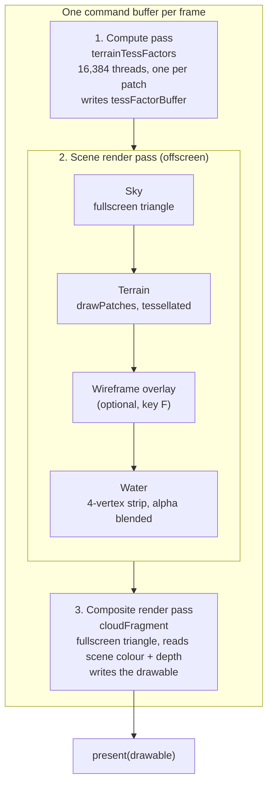

# Getaway engine documentation

Deep-dive notes on how each part of the renderer works. They describe the code as it exists in `Getaway/`, name the functions involved, and give the reasoning behind constants where the code makes it recoverable. Where a statement is an estimate derived from the code rather than something measured on hardware, it says so.

| Page | Covers |
| --- | --- |
| [1. Vertex and fragment shaders](01-vertex-and-fragment-shaders.md) | The Metal pipeline model, shader syntax, the shared `Uniforms` block, and a walk-through of the sky, terrain, wireframe and water shaders |
| [2. Tessellation](02-tessellation.md) | The compute kernel that picks tessellation factors, frustum culling, crack-free edges, the post-tessellation vertex shader |
| [3. Volumetric clouds](03-volumetric-clouds.md) | The depth-aware ray-marched cloud composite, cloud density, lighting, light shafts, and cloud shadows on the ground |

Not yet documented: material texture generation (`MaterialTextures.metal`), the procedural heightfield maths in depth (only summarised in page 1), input handling, and the Swift Playgrounds generator.

## One frame, start to finish

`Renderer.draw(in:)` encodes a single command buffer containing three GPU passes.

| Pass | Target | Depth | Shader entry points |
| --- | --- | --- | --- |
| Tessellation factors | `tessFactorBuffer` (GPU-private) | n/a | `terrainTessFactors` |
| Scene | `sceneColorTexture` + `sceneDepthTexture` (screen-sized, private) | Cleared to `0`, compare `.greater` (reversed-Z) | `skyVertex/skyFragment`, `terrainVertex/terrainFragment` (+ `terrainWireFragment`), `waterVertex/waterFragment` |
| Composite | the `MTKView` drawable | none attached | `skyVertex/cloudFragment` |

Why the scene goes to an offscreen texture first: the cloud pass needs to know how far away the nearest opaque surface is for every pixel so that clouds can pass in front of or behind terrain. A drawable's depth buffer is not shader-readable in the general case, so the scene pass renders to textures created with `usage = [.renderTarget, .shaderRead]` and the composite pass reads them. The textures are recreated whenever `drawableSize` changes (`mtkView(_:drawableSizeWillChange:)` clears them, `ensureSceneTextures` rebuilds them).

### Reversed-Z in one paragraph

The projection (`simd_float4x4.perspectiveReversedZ` in `MathUtilities.swift`) maps the near plane (0.5 units) to depth `1` and the far plane (30,000 units) to depth `0`. Depth is cleared to `0`, and the depth test is `.greater`, so a closer fragment, having a larger value, wins. Floating-point numbers have more precision near zero, and the usual perspective depth curve packs most values near 1; reversing the range puts the dense float precision where the curve is sparse, which reduces z-fighting at distance. Two consequences appear in the shaders: "no geometry here" is recognised by `depth == 0` (see `cloudFragment`), and sky/fullscreen triangles are emitted at clip `z = 0`, which is the far plane.

### Resource binding table

Binding indices must agree between `Renderer.swift` and the `[[buffer(n)]]`, `[[texture(n)]]` and `[[sampler(n)]]` attributes in the shaders.

| Shader | Stage | Binding | What | Set in `draw(in:)` |
| --- | --- | --- | --- | --- |
| `terrainTessFactors` | compute | buffer 0 / 1 / 2 / 3 | `Uniforms` / control points / factor output / patch count | `setBytes`, `setBuffer`, `setBuffer`, `setBytes` |
| `skyFragment` | fragment | buffer 0 | `Uniforms` | `setFragmentBytes` |
| `terrainVertex` | vertex | `stage_in` (attribute 0 from buffer 0), buffer 1 | patch control points, `Uniforms` | `setVertexBuffer(controlPointBuffer, 0)`, `setVertexBytes(…, 1)` |
| `terrainFragment` | fragment | buffer 0, texture 0, sampler 0 | `Uniforms`, material array, sampler | the buffer binding persists from the sky draw; texture and sampler set before the terrain draw |
| `terrainWireFragment` | fragment | buffer 0 | `Uniforms` | persists |
| `waterVertex` | vertex | buffer 0 | `Uniforms` | `setVertexBytes(…, 0)` (overwrites the control-point binding, which terrain no longer needs) |
| `waterFragment` | fragment | buffer 0 | `Uniforms` | persists |
| `cloudFragment` | fragment | buffer 0, texture 0, texture 1 | `Uniforms`, scene colour, scene depth | `setFragmentBytes`, `setFragmentTexture` ×2 |

Note on "persists": `MTLRenderCommandEncoder` keeps bound resources until they are replaced, so the single `setFragmentBytes(&uniforms, index: 0)` made for the sky is what the terrain, wireframe and water fragment shaders read. This works, but it is implicit state; if the sky draw were removed or reordered, those shaders would lose their uniforms.

### The `Uniforms` block

One 272-byte struct is rebuilt on the CPU each frame (`makeUniforms`) and copied to every shader that needs it.

| Field | Type | Contents |
| --- | --- | --- |
| `viewProjection` | `float4x4` | projection × view |
| `invViewProjection` | `float4x4` | its inverse, used to turn pixels back into world-space rays |
| `cameraPosition` | `float4` | `xyz` camera, `w` seconds since launch |
| `lodOrigin` | `float4` | `xyz` point tessellation distance is measured from (camera, or the frozen point) |
| `sunDirection` | `float4` | `xyz` unit vector towards the sun, constant `normalize(0.62, 0.34, -0.42)` ≈ (0.754, 0.413, −0.511), about 24.4° above the horizon |
| `frustumPlanes[4]` | `float4` ×4 | left, right, bottom, top planes, inward-facing, normalised |
| `terrainParams` | `float4` | `x` height scale (300), `y` base frequency (1/900), `z` water level (−45), `w` terrain size (8192) |
| `tessParams` | `float4` | `x` max tess factor (64 macOS / 16 elsewhere), `y` LOD scale (default 64), `z` patch size (64), `w` unused |

Layout: 2 × 64 (matrices) + 3 × 16 + 4 × 16 + 2 × 16 = 272 bytes. Everything is a 16-byte-aligned vector or matrix, so Swift and Metal agree on offsets without padding. The Swift side represents the plane array as a 4-element tuple of `SIMD4<Float>`, which is contiguous in memory like the Metal array. Keep both declarations in sync (a project rule in `AGENTS.md`).
